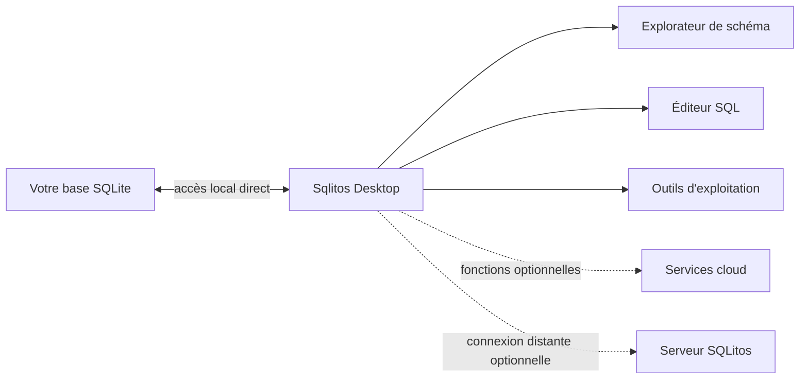

# Sqlitos

  <strong>Le studio de données local, pensé pour les équipes qui veulent garder le contrôle.</strong> 
  Explorez, concevez, interrogez et sécurisez vos bases SQLite depuis une application desktop moderne.

  
  
  

  <a href="#pourquoi-sqlitos">Pourquoi Sqlitos</a> ·
  <a href="#fonctionnalit%C3%A9s">Fonctionnalités</a> ·
  <a href="#installation">Installation</a> ·
  <a href="#confidentialit%C3%A9-par-d%C3%A9faut">Confidentialité</a> ·
  <a href="#s%C3%A9curit%C3%A9">Sécurité</a>

---

## Pourquoi Sqlitos

Les outils de données ne devraient pas obliger une équipe à déplacer ses fichiers, exposer ses identifiants ou sacrifier la qualité de l’expérience utilisateur. **Sqlitos est un studio desktop local-first** pour travailler directement avec des bases SQLite : une interface claire pour comprendre un schéma, exécuter des requêtes et effectuer des opérations sensibles avec intention.

Il convient aussi bien à l’exploration quotidienne d’un fichier `database.sqlite` qu’aux revues de schéma, migrations, diagnostics de performance et sauvegardes.

## Fonctionnalités

| Domaine | Ce que permet Sqlitos |
| --- | --- |
| **Explorer** | Parcourir tables, colonnes, clés étrangères, index, vues et triggers. |
| **Interroger** | Éditeur SQL avec historique, snippets, plan de requête et classification des requêtes. |
| **Concevoir** | Créer et modifier des tables, comparer des schémas et préparer des migrations. |
| **Opérer** | Contrôler la santé, les PRAGMA, le stockage, les sauvegardes, l’import et l’export. |
| **Rechercher** | Exploiter FTS5, les embeddings et les outils de recherche avancée. |
| **Collaborer** | Utiliser les fonctions optionnelles d’API, temps réel, planification et synchronisation cloud. |
| **Sécuriser** | Gérer les audits, l’authentification, les rôles et les préférences de protection. |

## Une architecture conçue pour le contrôle

- **Desktop-first** : l’application Electron travaille avec les fichiers SQLite locaux, sans serveur requis.
- **Séparation des responsabilités** : les accès local, navigateur et distant sont distincts afin que chaque environnement conserve ses garanties propres.
- **Extensions optionnelles** : les services cloud et le serveur distant complètent le produit sans devenir une dépendance pour l’usage local.

## Installation

### Installer l’application

1. Ouvrez la page [Releases](../../releases).
2. Téléchargez l’installateur correspondant à votre système.
3. Installez Sqlitos puis ouvrez votre fichier SQLite depuis l’écran de connexion.

> Les versions publiées et leurs notes de mise à jour seront disponibles dans les releases de ce dépôt.

### Prérequis système

| Système | Distribution prévue |
| --- | --- |
| Windows | Installeur `.exe` |
| macOS | Image disque `.dmg` |
| Linux | AppImage |

## Confidentialité par défaut

Votre base reste votre source de vérité. En usage desktop local, Sqlitos ouvre le fichier SQLite choisi directement sur votre machine. Aucune instance de serveur n’est nécessaire pour explorer un schéma ou exécuter des requêtes locales.

Les fonctions qui impliquent un service distant — par exemple une connexion HTTP, une sauvegarde externe ou des services cloud — sont distinctes et doivent être configurées explicitement.

## Sécurité

Sqlitos applique notamment les principes suivants :

- isolation de contexte et sandbox dans l’application desktop ;
- API IPC exposée de manière explicite entre l’interface et le système local ;
- validation des données aux frontières applicatives ;
- authentification par jeton pour le serveur distant facultatif ;
- configuration CORS restrictive par défaut pour ce serveur.

Ne publiez jamais de fichiers de base de données, de clés d’API ou de mots de passe dans une issue. Consultez [SECURITY.md](SECURITY.md) pour signaler une vulnérabilité de façon responsable.

## Ce dépôt

Ce dépôt est la **vitrine publique officielle** de Sqlitos. Il est volontairement limité à la documentation, aux annonces de versions et aux échanges avec la communauté ; il ne contient ni le code source de l’application, ni des secrets, ni des bases d’exemple distribuables.

Pour une demande de fonctionnalité, un retour produit ou une question d’intégration, ouvrez une issue en précisant le contexte, la version de Sqlitos et les étapes de reproduction. Consultez [CONTRIBUTING.md](CONTRIBUTING.md) pour le cadre de contribution.

## Feuille de route

- [ ] Publier les premiers installateurs signés.
- [ ] Ajouter captures d’écran et démonstrations produit aux releases.
- [ ] Documenter les intégrations de sauvegarde et de serveur distant.
- [ ] Ouvrir un espace de retours produit structuré.

## Contact

Pour les demandes commerciales, partenariats ou support privé, utilisez le canal de contact indiqué sur la page de profil de l’organisation GitHub qui publie ce dépôt.

---

  Conçu pour garder les données proches de celles et ceux qui les utilisent. 
  <strong>Sqlitos</strong>

