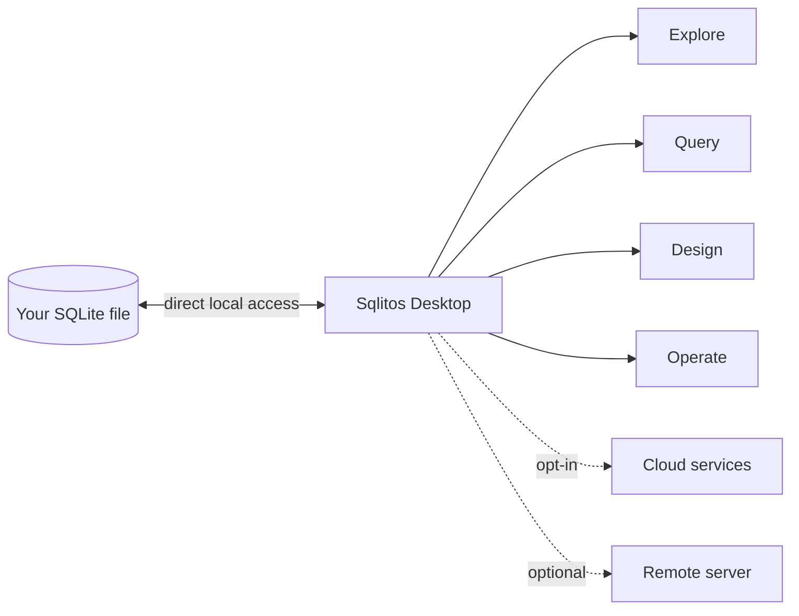

# Sqlitos

### Your database. Your machine. Your momentum.

**A modern, desktop-first workspace for exploring, designing and operating SQLite databases — without giving up control of your data.**

[Official website](https://sqlitos.vercel.app) · [Product guide](docs/PRODUCT.md) · [Releases](../../releases) · [Security](SECURITY.md) · [Feedback](../../issues)

 

> **Sqlitos turns a database file into a workspace.** Inspect the structure, write SQL with confidence, evolve schemas deliberately and keep operations close to the data they affect.

<table>
  <tr>
    <td width="33%"><strong>Local-first</strong> Open a SQLite file directly. A server is not the starting point.</td>
    <td width="33%"><strong>One surface</strong> Move from schema to SQL, migration and backup without changing tools.</td>
    <td width="33%"><strong>Deliberate operations</strong> See what changes before you apply it, and keep a useful record of the work.</td>
  </tr>
</table>

## Table of contents

- [The database workspace, rethought](#the-database-workspace-rethought)
- [The Sqlitos workflow](#the-sqlitos-workflow)
- [Built for the work around data](#built-for-the-work-around-data)
- [Workspaces with depth](#workspaces-with-depth)
- [Desktop-first by design](#desktop-first-by-design)
- [Your data stays yours](#your-data-stays-yours)
- [Getting started](#getting-started)
- [Product surface](#product-surface)
- [Security](#security)
- [This repository](#this-repository)

## The database workspace, rethought

Working with SQLite is usually fragmented: one tool to inspect tables, another to run queries, a third to understand relationships, and a collection of scripts for everything operational.

Sqlitos brings that work into one focused desktop experience. It is for developers, product builders and data-minded teams who need a fast path from **“What is in this database?”** to **“I understand it, I changed it safely, and I can explain what happened.”**

| From | To |
| --- | --- |
| Opening a file and guessing its shape | A navigable schema, relationships and operational context |
| One-off SQL and scattered scripts | A deliberate workspace with history, snippets and query tools |
| Risky schema changes | Inspectable diffs, migrations and database-aware guardrails |
| Local data hidden behind opaque files | A product experience built around visibility and control |

## The Sqlitos workflow

<table>
  <tr>
    <td valign="top" width="25%"><strong>01 — Open</strong>  Choose a SQLite file, reconnect to a workspace, or use an optional remote connection when the job needs one.</td>
    <td valign="top" width="25%"><strong>02 — Read</strong>  Map tables, relations, indexes, triggers and storage before touching a statement.</td>
    <td valign="top" width="25%"><strong>03 — Decide</strong>  Use SQL, query plans, diffs and generated migration drafts to make a change with context.</td>
    <td valign="top" width="25%"><strong>04 — Operate</strong>  Validate integrity, record the change, create a backup, or schedule the next routine operation.</td>
  </tr>
</table>

This is the product’s central idea: a database tool should preserve the chain of reasoning around a change, not merely provide a text box that can run it.

## Built for the work around data

### `01` Understand

Start with the structure. Explore tables, columns, foreign keys, indexes, views and triggers in a visual workspace designed to make unfamiliar databases legible. The schema canvas is the orientation layer; it gives every later query and schema decision a place.

### `02` Ask

Use a dedicated SQL editor with history, reusable snippets, result exploration and query-plan tooling. The goal is not merely to execute SQL — it is to understand its effect, reuse the intent and notice when a query is doing more work than expected.

### `03` Shape

Design tables, compare schemas and prepare migrations from the same place where you inspect the current state. Generated migration drafts call out changes that SQLite cannot safely automate, while migrations run transactionally and can include an explicit rollback path.

### `04` Operate

Move from development into confidence: integrity and foreign-key checks, WAL-aware health probes, PRAGMA inspection, backups, import/export, storage visibility and change-oriented diagnostics.

## Workspaces with depth

| Workspace | What it helps you do | Signals worth noticing |
| --- | --- | --- |
| **Schema & database browser** | Navigate tables, relations, views, triggers and row-level data. | Foreign-key relationships, generated SQL and object definitions. |
| **SQL & query plan** | Write, format, run and revisit SQL. Inspect how SQLite will execute it. | Query history, reusable snippets, result exploration and planner output. |
| **Designer & diff** | Model a table or compare two real SQLite files before changing production data. | Live SQL preview, constraints, unsafe-change warnings and exported migrations. |
| **Migrations** | Author, apply and roll back versioned database changes. | Applied history, transactional execution and optional down SQL. |
| **Health & operations** | Check integrity, inspect PRAGMAs, create backups and move data in or out. | Integrity probes, WAL state, backup records and audit-oriented activity. |
| **Search & vectors** | Work with FTS5 virtual tables and embedding-oriented local collections. | Full-text indexes, local vectorization and similarity search. |

For the complete capability map — including connection-mode requirements and operation boundaries — read the [Sqlitos product guide](docs/PRODUCT.md).

## Product surface

| Explore | Query | Build | Operate |
| :--- | :--- | :--- | :--- |
| Schema map | SQL editor | Table designer | Health monitor |
| Database browser | Query history | Migrations | Backups |
| Tables & relations | Query plans | Schema diff | Import / export |
| Storage view | Snippets | Indexes & triggers | PRAGMA controls |

<strong>More capabilities in the workspace</strong>

 

- Full-text search with SQLite FTS5
- Vector and embedding-oriented workflows
- Auto API and optional realtime capabilities
- Optional remote database connection
- Scheduled operations and notification-oriented tooling
- Authentication, role-aware controls and security-audit views

## Desktop-first by design

The local desktop app is the centre of Sqlitos. A server is not required to open and work with a SQLite file. Optional cloud and remote-server capabilities are additive: they support workflows that need them without redefining the local experience.

## Your data stays yours

Sqlitos is designed around a simple premise: **a local database should remain local unless you explicitly decide otherwise.**

- Open a SQLite file directly from your machine.
- Keep local exploration and SQL work independent of a hosted database service.
- Configure remote connections, backups or cloud features intentionally when your workflow calls for them.
- Keep secrets out of issues and public repositories.

## Getting started

### Discover Sqlitos

Visit [sqlitos.vercel.app](https://sqlitos.vercel.app) for the official product experience and current product information.

### Install the desktop app

When a version is available, download the installer for your platform from [Releases](../../releases):

| Platform | Distribution |
| --- | --- |
| Windows | `.exe` installer |
| macOS | `.dmg` disk image |
| Linux | AppImage |

Then open Sqlitos, choose a SQLite file and begin with the schema explorer.

## Security

Sqlitos uses a layered approach appropriate to desktop database work:

- isolated and sandboxed Electron renderer processes;
- explicit IPC boundaries between the interface and local system operations;
- runtime validation at application and server boundaries;
- bearer-token protection and restrictive CORS defaults for the optional remote server.

Please do not disclose vulnerabilities in public issues. Read [SECURITY.md](SECURITY.md) for responsible reporting.

## This repository

This is the official public home for the **Sqlitos product**: its positioning, public documentation, release notes and feedback.

The application source code is intentionally not published here. This keeps product code, development infrastructure and sensitive implementation details separate from the public product experience.

### Share feedback

Have a workflow Sqlitos should make easier? [Open an issue](../../issues) with the context, the desired outcome and — when reporting a defect — the version and steps to reproduce.

For documentation contributions and public feedback guidelines, see [CONTRIBUTING.md](CONTRIBUTING.md).

---

Built for people who want to move fast **without moving their data away**.

<a href="https://sqlitos.vercel.app"><strong>Explore Sqlitos →</strong></a>

